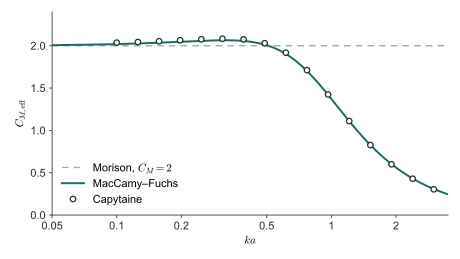

Added mass, radiation damping and wave excitation forces are fundamental hydrodynamic parameters in the design of floating offshore structures, and they are usually computed with boundary element codes based on linear potential-flow theory. Commercial packages such as WAMIT and ANSYS AQWA are well established but require a licence and do not provide their source code. Capytaine is an open-source alternative: it is used from Python, its source code is fully available, and it is actively maintained.

## Development

Capytaine originates from Nemoh, the open-source boundary element code developed at École Centrale de Nantes. It began as a Python interface to the core Fortran routines of Nemoh, was subsequently developed into a complete rewrite of Nemoh, and has since evolved independently. The project is led by Matthieu Ancellin; it started at University College Dublin in 2017 and has since received funding from the US National Renewable Energy Laboratory (NREL) and other organisations. Since version 3.0, released in August 2026, the code has been distributed under the Apache 2.0 licence, which permits commercial use.

## Capabilities

Capytaine solves the linear radiation and diffraction problems in the frequency domain, yielding added mass, radiation damping, Froude–Krylov and diffraction forces, and from these the response amplitude operators (RAO). The bodies may be single rigid bodies, multiple rigid bodies or structures with generalised degrees of freedom, in finite or infinite water depth. Post-processing provides the pressure and velocity in the flow field, the free-surface elevation and the Kochin function, as well as the hydrostatic stiffness and inertia matrices.

Capytaine also provides the following features: a lid on the interior waterplane of the body to remove irregular frequencies; faster computation for plane-symmetric bodies by exploiting their symmetry; the Green function of HAMS as an alternative to that of Nemoh; and an approximate treatment of forward speed for a single rigid body. Results are returned as xarray datasets, which can be used directly in Python data-analysis workflows or saved as NetCDF files.

In our [work on wave load identification](/en/updates/fixed-structure-loads/), its Green function library was also used to compute the transfer matrices.

## Verification against the analytical solution for a cylinder

The cylinder demonstration in the [wave lab](/en/updates/wave-lab/) uses the MacCamy–Fuchs analytical solution. The same problem was computed with Capytaine for a cylinder of radius 1 m standing on the seabed in a water depth of 5 m, with the wetted surface discretised into 72 × 40 = 2880 panels. The horizontal wave force was computed at 16 frequencies, which took about 2.5 min on a personal computer. Expressed as an effective inertia coefficient, the numerical results deviate from the analytical solution by less than 1.2% over the whole range.

## Citation

When Capytaine is used in a publication, the developers ask that both of the following be cited:

- Ancellin M, Dias F. Capytaine: a Python-based linear potential flow solver. *Journal of Open Source Software*, 2019, 4(36): 1341.
- Babarit A, Delhommeau G. Theoretical and numerical aspects of the open source BEM solver NEMOH. *Proceedings of the 11th European Wave and Tidal Energy Conference (EWTEC2015)*, Nantes, 2015.
