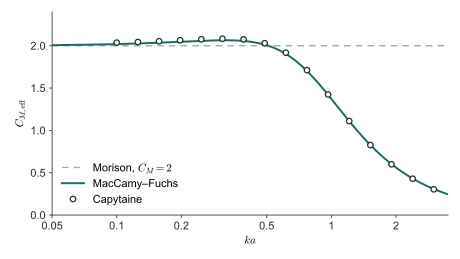

附加质量、辐射阻尼和波浪激振力是海上浮式结构设计中的基本水动力参数，通常采用基于线性势流理论的边界元程序计算。WAMIT、ANSYS AQWA 等商业软件功能完善，但需购买授权，源代码也不公开。Capytaine 是一款开源的替代工具：通过 Python 调用，源代码完全公开，并持续维护更新。

## 发展历程

Capytaine 源自法国南特中央理工学院（École Centrale de Nantes）开发的开源边界元程序 Nemoh。该项目最初是 Nemoh 核心 Fortran 程序的 Python 接口，后逐步发展为对 Nemoh 的完整重写，并独立演进。项目由 Matthieu Ancellin 主持开发，2017 年始于都柏林大学学院（University College Dublin），此后先后获得美国国家可再生能源实验室（NREL）等机构的资助。自 2026 年 8 月发布的 3.0 版起，代码改用 Apache 2.0 许可证，允许商业使用。

## 主要功能

Capytaine 在频域中求解线性辐射与绕射问题，计算附加质量、辐射阻尼、Froude–Krylov 力和绕射力，并可进一步求解运动响应（RAO）。计算对象可以是单个刚体、多刚体系统或具有广义自由度的结构；水深可取有限水深，也可按无限水深处理。后处理可给出流场中的压力与速度、自由面高程和 Kochin 函数，并计算静水刚度矩阵与惯性矩阵。

Capytaine 还提供以下功能：在浮体内部的水线面上设置盖板以消除不规则频率；对具有平面对称性的物体利用对称性加速计算；除 Nemoh 原有的格林函数外，可选用 HAMS 的格林函数；对单个刚体可考虑近似的航速效应。计算结果以 xarray 数据集的形式返回，可直接用于 Python 数据分析流程，也可保存为 NetCDF 文件。

我们在[波浪荷载识别工作](/zh/updates/fixed-structure-loads/)中，也采用其格林函数库计算传递矩阵。

## 圆柱绕射解析解的复核

[波浪互动实验室](/zh/updates/wave-lab/)中的圆柱绕射演示采用 MacCamy–Fuchs 解析解。采用 Capytaine 计算同一问题：半径 1 m 的圆柱立于水深 5 m 的海底，浸水柱面划分为 72×40 共 2880 个面元，计算 16 个频率下的水平波浪力，在一台个人计算机上耗时约 2.5 min。将波浪力换算为等效惯性系数后，数值结果与解析解在整个计算范围内的偏差均小于 1.2%。

## 引用

在论文中使用 Capytaine 时，官方建议同时引用以下两篇文献：

- Ancellin M, Dias F. Capytaine: a Python-based linear potential flow solver. *Journal of Open Source Software*, 2019, 4(36): 1341.
- Babarit A, Delhommeau G. Theoretical and numerical aspects of the open source BEM solver NEMOH. *Proceedings of the 11th European Wave and Tidal Energy Conference (EWTEC2015)*, Nantes, 2015.
