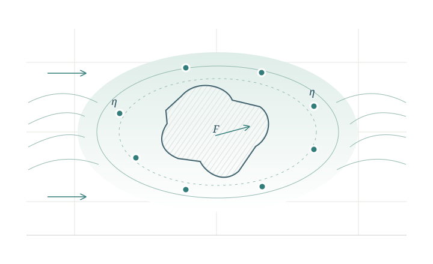
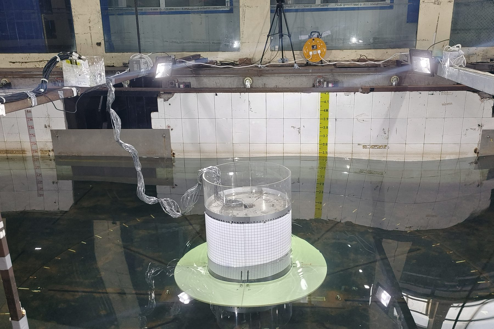
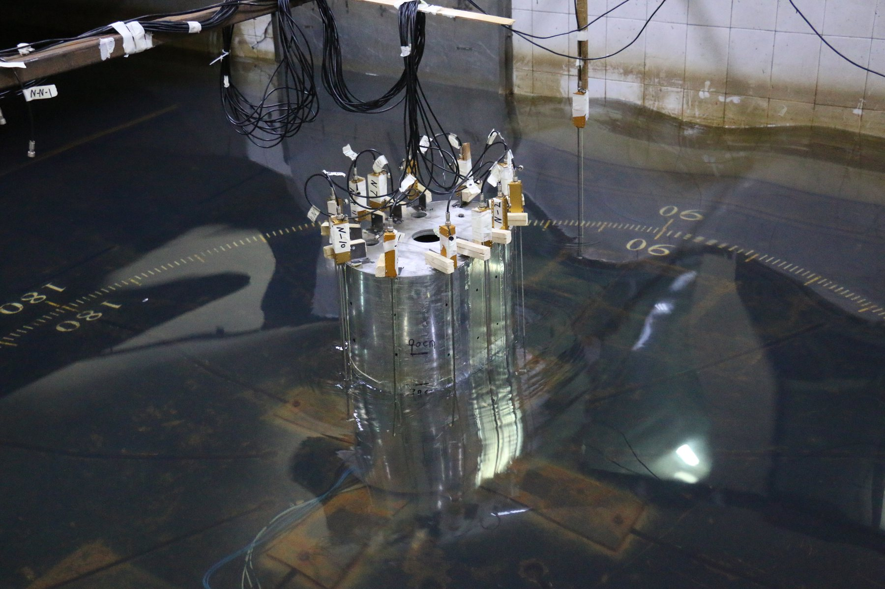
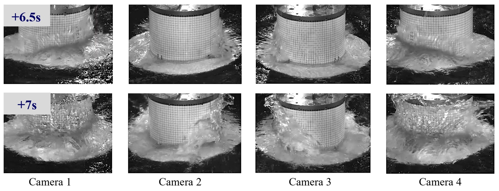

A laboratory model can be mounted on a force balance to measure the load directly, but a bridge pier or a wind-turbine foundation at sea cannot be measured this way, and pressure sensors on the structure surface are costly to install and maintain in the field. Estimating wave loads from the water surface is a common alternative, but the usual approaches either use only the incident wave height and period, which yields statistical design loads, or take the surface at a measurement point as the incident wave, which holds only for slender piles. The question this work addresses is whether the surface records at a few points around a structure alone can give the time history of the wave load on it in real time.

## How a structure reshapes the waves around it

For a slender pile, the structure disturbs the waves very little, so the surface measured beside it can be taken as the incident wave. Linear wave theory gives the particle velocity and acceleration, and the Morison equation (Morison et al., 1950) then gives an estimate of the load.

A larger structure behaves differently. Waves rise against its front, pass around its sides and leave a sheltered region behind it, so any point nearby records the incident wave superposed on the diffracted one (the cylinder diffraction demonstration in the [wave lab](/en/updates/wave-lab/) shows this). Separating the incident wave from such records is a difficult inverse problem.

## From surface to pressure: a precomputed transfer matrix

This work does not reconstruct the incident wave; instead, it maps the surface elevation directly to the pressure on the structure. The analysis concerns only the fluid immediately adjacent to the structure: there the fluid cannot pass through the structure surface, and the pressure on the surface and the surrounding surface elevation are determined by the same potential-flow solution.

The incident part is represented by a series of cylindrical waves with unknown coefficients, which are eliminated in the derivation and need not be solved for. The resulting mapping depends only on the geometry, the water depth and the wave frequency, so it can be computed frequency by frequency before the experiment, using a Green function and the boundary element method, and stored as a transfer matrix.

During identification, each new segment of surface data is first Fourier transformed into its frequency components, which are then multiplied by the transfer matrices of the corresponding frequencies. This gives the pressure on every panel of the structure, and integrating over the surface gives the load. Because the matrices are precomputed, this step is cheap, and the load history can be updated in real time as measurements arrive. The geometry enters only through the matrices; the identification procedure is the same for any shape. Liu et al. (2018) developed this type of method for cylinders, and this work extends it to fixed structures of arbitrary shape.

## Validation in a wave flume

The experiments were carried out in a wave flume 50 m long and 5 m wide, with a water depth of 0.8 m. Each model was fixed at the centre of the flume on a force balance, whose readings served only as a reference and were not used in the identification. The three models represent three typical structures: a cylinder, as in the monopile foundation of an offshore wind turbine; a column with a racetrack-shaped cross-section, common in bridge foundations; and a cylinder fitted with an annular curved plate near the surface, which dissipates wave energy and reduces the load on the column.

In the tests on the cylinder and the plated cylinder, no instrument was placed in the water. Four cameras on both sides of the flume recorded the model, and the waterline on its surface was extracted from the images (the extraction method is described in [this post](/en/updates/sam2/)). The racetrack model was instead surrounded by 12 wave gauges.

The video below shows the identification for the cylinder in irregular waves. The black line at the upper left is the load measured by the balance, and the red dotted line is the load identified from the four camera images alone.

<figure>
<video controls muted loop playsinline preload="metadata" poster="./cylinder-video-poster.jpg">
  <source src="./cylinder-video.mp4" type="video/mp4" />
</video>
<figcaption>Identification for the cylinder in irregular waves, played at twice the speed; the four camera views are shown below.</figcaption>
</figure>

The identification error was 3.64% for the cylinder and 1.96% for the racetrack section (root-mean-square error normalised by the range of the measured load).

 regular waves; (b) irregular waves.")

## Number and placement of measurement points

The 12 gauges around the racetrack model were also used to examine the effect of the number and placement of the points. With a single point, the accuracy depends strongly on its position, with errors ranging from about 4% to nearly 16%. With four points the error falls to about 2%, and beyond six points the placement has almost no effect. More points are not necessarily better: closely spaced points carry highly correlated information, which makes the transfer matrix ill-conditioned and the solution less stable.

For a vertical cylinder standing on the seabed, this question can be checked against an analytical solution. In linear theory, the horizontal wave force on the cylinder depends only on the first circumferential component of the surface along the waterline. The demonstration below takes $W$ points on the waterline, writes the waterline surface as a series with unknown coefficients, finds the coefficients from the point values and from them the force, following the same idea as this work. The exact force for comparison comes from the MacCamy–Fuchs solution (MacCamy and Fuchs, 1954), and the formulas are listed below the demonstration.

<iframe class="demo-frame" src="/demos/waterline-force/index.html?lang=en" title="Interactive demonstration of identifying the wave force from the waterline" loading="lazy"></iframe>

With the default parameters, the two points sit at the front and the back of the cylinder, and the error is below 1%. Setting the first point to $\beta_0 = 90^\circ$ moves both points to the sides, and the error rises to 35%: the surface at the sides has zero weight in the waterline integral, so the identified force is zero. As points are added, the difference in error between placements shrinks quickly. With few points, the higher circumferential components of the waterline surface alias into the first one; a larger diameter means stronger diffraction and larger higher components, so more points are needed.

These trends resemble the experimental results above, but the two come from different sources. The errors in the demonstration are computed from theory: the cylinder is fixed, the waves are regular and the point values carry no measurement error, so the error comes only from the number and placement of the points. The errors above come from flume measurements on the racetrack model and also include the effects of measurement error, model discretisation error, wave nonlinearity and viscosity. The numbers are sometimes close, but the two cannot be equated.

## Wave breaking and impact

The plated cylinder posed the most demanding conditions. With the plate close to the surface, large waves broke there and struck the plate and the column, and the sharp waterline in the camera images was obscured by extensive splashing.

The identification error for this case was 9.25%. The sharp load peaks recorded by the balance at the instants of impact lie beyond the range of validity of potential-flow theory and cannot be reproduced by the transfer matrices, but the timing of the peaks is still identified accurately. If a slamming-load model is introduced in future work, the amplitude of the peaks can be corrected with relative ease.

## Extreme loads and the arrival delay of the crest

Structural design is often concerned with extreme sea states. A common practice in offshore engineering is to align the largest crests in a long record and average them, giving the shape of the average largest wave (Whittaker et al., 2016); the NewWave design wave (Tromans et al., 1991) rests on the same idea. Wave height and load do not correspond one to one, however, and the highest wave does not necessarily produce the largest load, so the average largest load cannot be obtained directly from the average largest wave.

This work uses the average largest waves at the points around the structure directly as the input to the transfer matrices. For the 240 s record of the racetrack model, with the largest 10% of crests averaged, the first identification gave a peak load of only about 60% of the measured value.

The discrepancy comes from the averaging itself. The record of each gauge is aligned at its own crests at time zero, so after averaging, the crests at all 12 points occur simultaneously, as though the wave acted on every side of the structure at once. In reality the crest reaches the front first, then the sides, and finally the back. Once the average arrival delay of the crests at each gauge is determined and the surface shifted accordingly, the identified average largest load agrees with the measurement.

, (c) Each gauge averaged on its own, so the crests are aligned at the same instant and the identified load is too small; (b), (d) shifted by the order in which the crest reaches each gauge, the identified load matches the measurement.")

## Paper

Liu J, **Qing J**, Whittaker C, Yan J, Guo A. Wave load identification for fixed structures of arbitrary shape from in situ wave elevation measurements. *Experiments in Fluids*, 2026, 67(2): 19.

## References

- Liu J, Guo A, Li H, Hu H. Methodology for wave force monitoring of bottom-mounted cylinder using the measurement of the wave surface elevation around the body surface. *Journal of Fluids and Structures*, 2018, 78: 197–214.
- MacCamy R C, Fuchs R A. *Wave Forces on Piles: A Diffraction Theory*. Technical Memorandum No. 69, Beach Erosion Board, U.S. Army Corps of Engineers, 1954.
- Morison J R, O'Brien M P, Johnson J W, Schaaf S A. The force exerted by surface waves on piles. *Journal of Petroleum Technology*, 1950, 2(5): 149–154.
- Tromans P S, Anaturk A R, Hagemeijer P. A new model for the kinematics of large ocean waves: application as a design wave. *Proceedings of the 1st International Offshore and Polar Engineering Conference*, Edinburgh, 1991, 3: 64–71.
- Whittaker C N, Raby A C, Fitzgerald C J, Taylor P H. The average shape of large waves in the coastal zone. *Coastal Engineering*, 2016, 114: 253–264.
