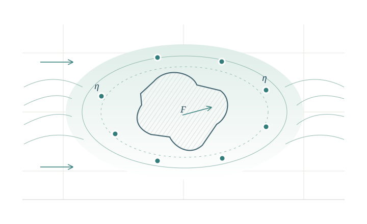
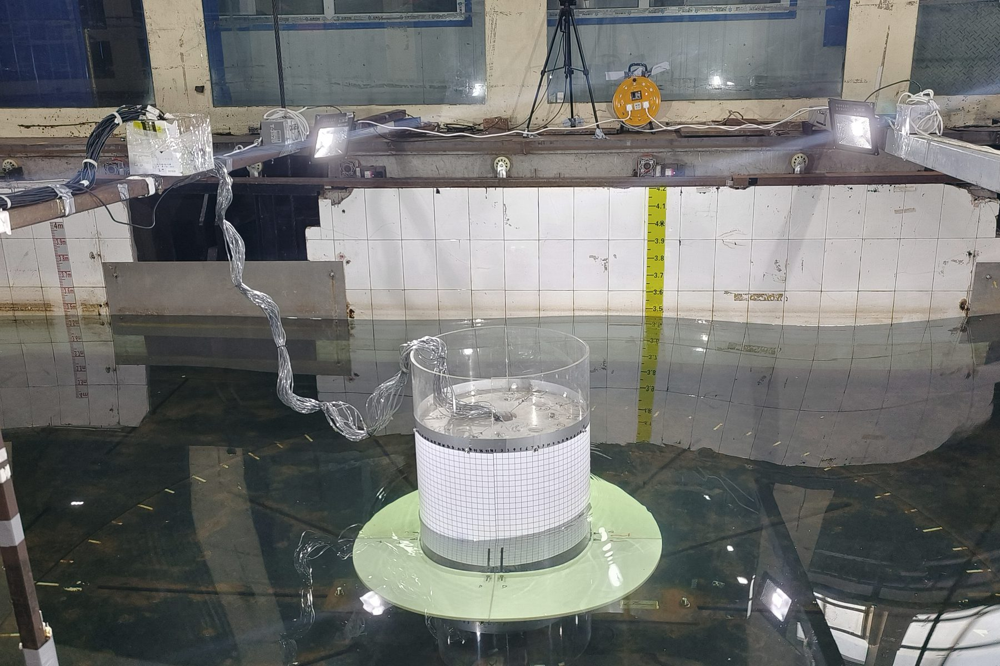
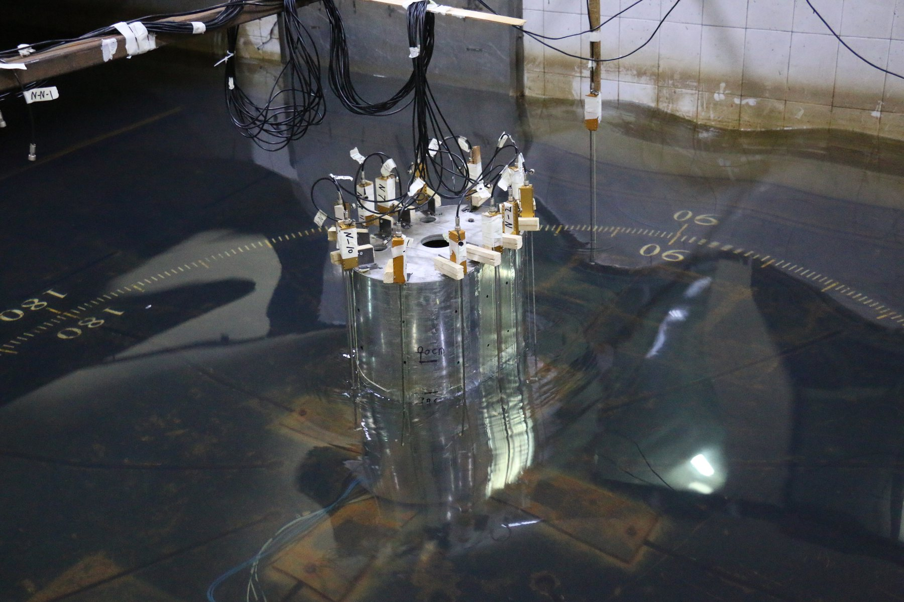
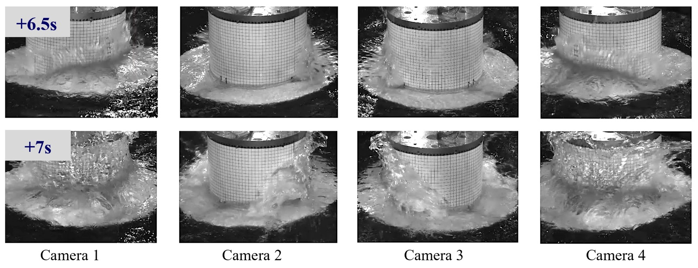

实验室中的模型可以安装在测力天平上直接测量荷载，海上的桥墩和风机基础却无法这样测量；在结构表面布设压力传感器，现场安装和维护的成本又很高。由波面估计波浪荷载是常用的替代途径，但常见做法或者只用入射波的波高和周期，得到统计意义上的设计荷载；或者把测点处的波面直接当作入射波，只适用于细长桩柱。这项工作研究的问题是：能否仅凭结构周围少数测点的波面记录，实时给出结构所受波浪荷载的时程。

## 结构改变了周围的波浪

对于细长桩柱，结构对波浪的扰动很小，桩旁测得的波面可以近似看作入射波。由线性波理论求出水质点的速度和加速度，代入 Morison 公式（Morison 等，1950），即可估算荷载。

尺度较大的结构则不同。波浪在迎浪面壅高，绕过两侧，并在背浪面形成遮蔽区，结构附近任一点记录到的都是入射波与绕射波的叠加（[波浪互动实验室](/zh/updates/wave-lab/)中的圆柱绕射演示展示了这一过程）。从这类记录中分离出入射波，是一个困难的反问题。

## 从波面到压力：预先计算的传递矩阵

这项工作不重建入射波，而是直接建立波面与结构表面压力之间的映射。分析只针对紧邻结构的流体区域：在这一区域内，流体不能穿透结构表面，结构表面的压力与周围的波面高程由同一个势流解确定。

入射波部分用一组系数未知的柱面波级数表示，这些系数在推导中被消去，无需求解。由此得到的映射只取决于结构形状、水深和波浪频率，可以在试验前用格林函数和边界元法逐个频率计算，存储为传递矩阵。

识别时，每获得一段新的波面数据，先经傅里叶变换得到各频率分量，再与对应频率的传递矩阵相乘，得到结构表面各单元上的压力，沿表面积分即得荷载。传递矩阵已预先计算，这一步的计算量很小，荷载时程可以随测量实时更新。结构形状只影响传递矩阵的计算，识别流程对任何形状都相同。Liu 等（2018）针对圆柱建立了这类方法，这项工作将其推广到任意形状的固定结构。

## 水槽试验验证

试验在长 50 m、宽 5 m 的波浪水槽中进行，水深 0.8 m。模型固定在水槽中央，底部连接测力天平，天平读数仅作为对照，不参与识别。三个模型分别对应三类典型结构：圆柱，如海上风机的单桩基础；跑道形截面柱，常见于桥梁基础；以及在近水面处加装环形弧板的圆柱，弧板用于消耗波能、降低柱体所受荷载。

圆柱和带板圆柱两组试验中，水体内没有布置任何测量仪器：四台相机架设在水槽两侧，从图像中提取模型表面的水线（提取方法见[分享](/zh/updates/sam2/)）。跑道形截面一组则在模型周围布置了 12 根浪高仪。

下面的视频展示圆柱模型在不规则波中的识别过程：左上方黑线为天平实测荷载，红色点线为仅由四台相机图像识别出的荷载。

<figure>
<video controls muted loop playsinline preload="metadata" poster="./cylinder-video-poster.jpg">
  <source src="./cylinder-video.mp4" type="video/mp4" />
</video>
<figcaption>圆柱模型在不规则波中的识别过程，两倍速播放；下方为四台相机的画面。</figcaption>
</figure>

圆柱模型的识别误差为 3.64%，跑道形截面为 1.96%（均方根误差，以实测荷载的变化范围归一化）。

 规则波；(b) 不规则波。")

## 测点数量与布置

跑道形截面一组的 12 根浪高仪还可用于检验测点数量和布置的影响。只用一个测点时，识别精度高度依赖其位置，误差在约 4% 到接近 16% 之间；测点增至 4 个，误差降到 2% 左右；达到 6 个以上，布置方式对结果几乎没有影响。测点也并非越多越好：间距过小的测点提供的信息高度相关，会使传递矩阵趋于病态，降低求解的稳定性。

对于直立在海底的圆柱，这一问题可以与解析解对照。线性理论下，圆柱所受的水平波浪力只取决于水线上波面的一阶圆周分量。下面的演示在水线上取 $W$ 个测点，把水线波面写成系数未知的级数，由测点值求出系数，进而求得波浪力，思路与这项工作的方法一致。作为对照的精确波浪力由 MacCamy–Fuchs 解（MacCamy 和 Fuchs，1954）给出，公式列在演示下方。

<iframe class="demo-frame" src="/demos/waterline-force/index.html?lang=zh" title="由水线波面识别波浪力互动演示" loading="lazy"></iframe>

默认参数下，两个测点分别位于迎浪点和背浪点，识别误差不到 1%。把首个测点的位置 $\beta_0$ 调到 $90^\circ$，两个测点转到圆柱两侧，误差升至 35%：两侧的波面在水线积分中的权重为零，识别出的力因此为零。增加测点后，不同布置之间的误差差异迅速缩小。测点较少时，水线波面中较高阶的圆周分量会混叠到一阶分量中；圆柱直径增大时绕射增强，这些高阶分量随之变大，所需的测点也更多。

这些规律与上面的试验结果相近，但两者的来源不同。演示中的误差是理论计算结果：圆柱固定，波浪为规则波，测点值没有测量误差，误差只来自测点的数量和布置。上面的误差则来自跑道形截面模型的水槽实测数据，其中还包含测量误差、模型离散误差、波浪非线性和黏性等因素的影响。两者的数值有时很接近，但不能一概而论。

## 波浪破碎与拍击

带板圆柱一组的条件最为苛刻。弧板位于水面附近，大波在此破碎并拍击板面和柱身，相机图像中原本清晰的水线被大片飞溅的水花遮挡。

该组的识别误差为 9.25%。拍击瞬间天平记录到的尖峰荷载超出了势流理论的适用范围，传递矩阵无法再现；但荷载峰值出现的时刻仍能准确识别。后续若引入拍击荷载模型，可以较方便地修正峰值的幅值。

## 极值荷载与波峰的到达时差

结构设计关注的往往是极端海况。海洋工程中常把长时记录中最大的若干波峰对齐后取平均，得到“平均最大波”的形状（Whittaker 等，2016），设计波 NewWave（Tromans 等，1991）也基于这一思想。然而波高与荷载并非一一对应，最高的波未必产生最大的荷载，由平均最大波不能直接推得平均最大荷载。

这项工作尝试将结构周围各测点的平均最大波直接作为传递矩阵的输入。以跑道形截面一组 240 s 的记录为例，取最大的 10% 波峰进行平均，初次识别得到的荷载峰值仅为实测值的 60% 左右。

偏差来自平均过程本身。各浪高仪的记录分别以各自的波峰对齐到零时刻，平均之后，12 个测点的波峰同时出现，相当于假定波浪同时作用在结构四周；而实际上，波峰依次到达迎浪面、两侧和背浪面。统计各测点波峰的平均滞后时间并据此平移波面后，识别出的平均最大荷载与实测吻合。

(c) 各测点分别平均，波峰被对齐到同一时刻，识别荷载偏小；(b)(d) 按波峰到达各测点的先后平移后，识别荷载与实测吻合。")

## 论文

Liu J, **Qing J**, Whittaker C, Yan J, Guo A. Wave load identification for fixed structures of arbitrary shape from in situ wave elevation measurements. *Experiments in Fluids*, 2026, 67(2): 19.

## 参考文献

- Liu J, Guo A, Li H, Hu H. Methodology for wave force monitoring of bottom-mounted cylinder using the measurement of the wave surface elevation around the body surface. *Journal of Fluids and Structures*, 2018, 78: 197–214.
- MacCamy R C, Fuchs R A. *Wave Forces on Piles: A Diffraction Theory*. Technical Memorandum No. 69, Beach Erosion Board, U.S. Army Corps of Engineers, 1954.
- Morison J R, O'Brien M P, Johnson J W, Schaaf S A. The force exerted by surface waves on piles. *Journal of Petroleum Technology*, 1950, 2(5): 149–154.
- Tromans P S, Anaturk A R, Hagemeijer P. A new model for the kinematics of large ocean waves: application as a design wave. *Proceedings of the 1st International Offshore and Polar Engineering Conference*, Edinburgh, 1991, 3: 64–71.
- Whittaker C N, Raby A C, Fitzgerald C J, Taylor P H. The average shape of large waves in the coastal zone. *Coastal Engineering*, 2016, 114: 253–264.
