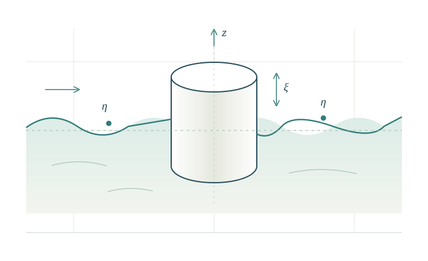

Floating wind-turbine foundations, aquaculture cages and ships move with the waves instead of standing still like a bridge pier. The observed surface then contains the waves generated by the motion of the structure, and the surface-based identification developed for fixed structures (see <a href="/en/updates/fixed-structure-loads/">the companion post</a>) cannot be applied directly. This work brings the motion into the identification: the surface elevation is observed at a few points along the waterline of the floating body, its own motion is recorded at the same time, and the time history of the wave load on it is obtained in real time.

## Waves generated by the motion of the structure

A floating body radiates waves as it moves. Even without incident waves, towing the structure makes the water ahead of it rise quickly and the water behind it fall back slowly, and the structure experiences wave-making resistance. In an idealised decomposition, the surface contains the incident, diffracted and radiated waves together.

For a cylinder standing on the seabed, earlier methods give the load directly from the surrounding surface (Liu et al., 2018). A floating body is different: its surface is itself moving, so the load depends both on the surrounding surface and on the velocity of the structure. Those methods were also built on a semi-analytical solution for cylinders, which is difficult to extend to other shapes.

## Observing with the floating body

This work carries out the identification in a coordinate system that moves with the floating body. In that frame the measurement points stay fixed relative to the structure, and the surface is always measured along its waterline and extracted by computer vision; in practice, cameras or wave radars can be mounted directly on the floating body. Observation in an earth-fixed frame is also possible, and our subsequent work has examined the feasibility of fixed measurement points.

The surface of the floating body is no longer a stationary impermeable boundary but moves with the structure. With this moving boundary condition included in the potential-flow solution, the pressure on the structure is determined by two contributions: one from the surrounding surface elevation and one from the velocity of the structure itself. Accordingly, we construct from these physical relations two sets of transfer matrices, acting on the surface record and on the motion record. They depend only on the geometry, the water depth and the wave frequency, and can be computed in advance. During identification, the surface and motion data are Fourier transformed and multiplied by the transfer matrices, giving the pressure on every panel of the structure and the resultant load. The computation is light, so the load history can be updated in real time as measurements arrive. Because the surface is discretised into panels, the method itself is not restricted to cylinders.

## Experimental validation

The experiments were carried out in a wave flume 50 m long and 5 m wide, with a water depth of 0.8 m. The cylinder had a radius of 0.2 m and a still-water draft of 0.28 m, and was connected by rigid rods to force transducers on a platform below. The platform had guide rails and a pivot axis: with the pivot locked, the cylinder could only move back and forth along the direction of wave travel (surge); with the pivot released, it also moved up and down (heave) and rocked fore and aft (pitch). The force transducers measured the total force; the measured wave force was obtained by subtracting the inertial force, from an accelerometer on top of the cylinder, and the hydrostatic restoring force. Optical markers on the side of the cylinder were tracked by a motion-capture system to give the rigid-body motion.

 the cylinder in the flume with the accelerometer, markers, force transducer, guide rails and pivot axis; (b) geometry of the cylinder and the platform.")

The surface was measured by four cameras placed around the cylinder and recording synchronously at 20 frames per second. The open-source segmentation model SAM 2 from Meta (see [this post](/en/updates/sam2/)) separated the part of the cylinder above the water in every frame; its lower edge is the waterline, which was then converted into the surface elevation at points along it. Although the cameras stood on the flume sides, what they extracted was always the surface along the waterline of the floating body, which is equivalent to observing in the body-fixed frame.

 camera arrangement and experimental scene; (b) the image sequence is segmented into a mask sequence, from which the elevation history along the waterline is extracted.")

## Three kinds of motion

In the first case no waves were generated. The cylinder was towed back and forth in surge by steel cables, so the force on it came entirely from the waves it made itself. The identification error was 3.87% (root-mean-square error normalised by the range of the measured load). During the pause in motion (around 50–60 s), the waves left from the previous stage were still on the surface, and the identification also recovered this residual load.

<figure>
<video controls muted loop playsinline preload="metadata" poster="./towing-video-poster.jpg">
  <source src="./towing-video.mp4" type="video/mp4" />
</video>
<figcaption>Case 1: the cylinder towed in surge by steel cables, played at twice the speed. On the left, from top to bottom: surface elevation on the wave-facing and sheltered sides, cylinder displacement, and horizontal force (black: measured; red dotted: identified). On the right: the layout, the motion-capture camera view and the four camera views.</figcaption>
</figure>

The second case used irregular waves (significant wave height 0.141 m, peak period 1.417 s), with the cylinder driven in surge by the waves. The identification errors were 3.65% for the horizontal force and 3.62% for the vertical force.

<figure>
<video controls muted loop playsinline preload="metadata" poster="./surge-video-poster.jpg">
  <source src="./surge-video.mp4" type="video/mp4" />
</video>
<figcaption>Case 2: the cylinder surging in irregular waves, played at twice the speed. On the left: horizontal and vertical forces (black: measured; red dotted: identified). On the right: the four camera views.</figcaption>
</figure>

In the third case the pivot was released, and the cylinder underwent coupled surge, heave and pitch in the same waves. The error was 4.56% for the vertical force and rose to 7.36% for the horizontal force, mainly as underestimated peaks and troughs. The pitch angles in this case were large, beyond the small-angle assumption of the method, and the wetted surface changed as the cylinder rocked, whereas the computation used a time-averaged wetted surface.

<figure>
<video controls muted loop playsinline preload="metadata" poster="./coupled-video-poster.jpg">
  <source src="./coupled-video.mp4" type="video/mp4" />
</video>
<figcaption>Case 3: the cylinder in coupled surge, heave and pitch in irregular waves, played at twice the speed. On the left: horizontal and vertical forces (black: measured; red dotted: identified). On the right: the four camera views.</figcaption>
</figure>

## Number and placement of measurement points

Because the waterline is extracted continuously from the images, virtual measurement points can be placed anywhere along it, which allows a systematic test of their number and placement. With a single point, the error in the horizontal force ranges from about 12% to nearly 40% depending on its position. With two points, one at the front and one at the back of the cylinder, the error falls to about 4%, close to the result with 41 points; with the two points on the sides instead, it exceeds 20%. Beyond five points, the placement has almost no effect. The vertical force is less demanding.

: (a) layouts of the points; (b) error against the angular position for two points; (c), (d) error in the horizontal and vertical forces against the number of points, with the shaded band showing the range over different placements.")

In the experiments the waves were unidirectional and the motion was constrained by the platform. For multidirectional waves and motion in several degrees of freedom in the field, the paper recommends at least five points. The [post on fixed structures](/en/updates/fixed-structure-loads/#number-and-placement-of-measurement-points) includes an interactive demonstration in which the points can be moved along the waterline of a fixed cylinder, showing a similar pattern.

## How motion affects the identification

The demonstration below illustrates the role of the motion with a theoretical calculation. A cylinder moves back and forth along the waves in an irregular sea, and a few points on its waterline, moving with it, record the surface. Two identifications are compared: from the surface at the points alone, which amounts to applying the method for fixed structures, and from the surface together with the motion of the cylinder, which is the idea of this work. To keep an exact solution, the cylinder in the demonstration spans the full depth, is held by a spring and moves only in surge, unlike the floating cylinder in the experiments.

<iframe class="demo-frame" src="/demos/moving-cylinder/index.html?lang=en" title="Interactive demonstration of identifying the wave load on a moving cylinder" loading="lazy"></iframe>

With the default parameters, the error is about 1.4% when the motion is included and about 4.2% from the surface alone, which overestimates the load overall. In this demonstration, the part of the cylinder's own waves that travels outwards relates to the pressure just as the incident wave does, so the method for fixed structures converts it correctly. The local disturbance that exists only near the cylinder does not, and the surface it raises on the waterline is turned into a force that is not there. The deeper the water, the stronger this effect and the larger the error from the surface alone. With more points, the error with the motion included tends to zero, while the error from the surface alone does not decrease.

These numbers come from linear theory, with no measurement error in the point values or the motion, whereas the errors reported in the paper come from measurements in the flume; the two cannot be equated. The demonstration uses a cylinder for the theoretical derivation, but the method itself is built on a discretised surface and can be applied to a range of shapes.

## Paper

**Qing J**, Liu J, Yan J, Whittaker C, Guo A. Wave load identification for a floating cylinder using in-situ wave elevation and structural motion data. *Journal of Fluids and Structures*, 2026, 141: 104485.

## References

- Liu J, Guo A, Li H, Hu H. Methodology for wave force monitoring of bottom-mounted cylinder using the measurement of the wave surface elevation around the body surface. *Journal of Fluids and Structures*, 2018, 78: 197–214.
- Ravi N, Gabeur V, Hu Y-T, et al. SAM 2: Segment anything in images and videos. arXiv:2408.00714, 2024.
