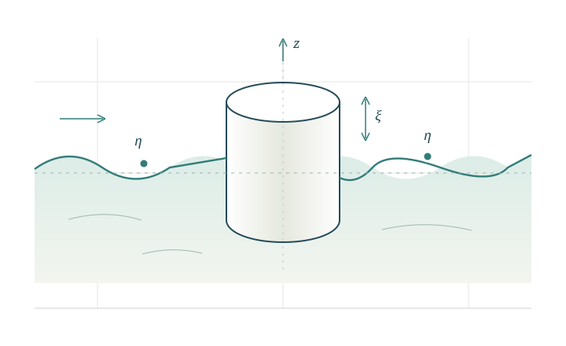

海上风机的浮式基础、养殖网箱和船舶都会随波浪摇荡，不像桥墩那样固定在原处。此时，液面观测包含了结构运动激起的波浪，由固定结构建立的波面识别方法（见<a href="/zh/updates/fixed-structure-loads/">另一篇</a>）不能直接沿用。这项工作把结构运动纳入识别：沿浮体水线观测少数几个点的波面，同时记录浮体自身的运动，实时给出它所受的波浪荷载时程。

## 结构运动导致的波

浮体运动时会向四周辐射波浪。即使没有入射波，只要拖动结构，运动方向前方的水面便迅速壅高，后方的水面缓慢回落，结构因此受到兴波阻力。以理想方式对波浪分离，波面同时包含入射波、绕射波和这种辐射波。

对于立在海底的圆柱，已有方法可以由周围波面直接给出荷载（Liu 等，2018）。浮体则不同：结构表面本身在运动，荷载既取决于周围的波面，也取决于结构的运动速度。以往的方法还建立在圆柱的半解析解之上，难以推广到其他形状。

## 随浮体一起观测

这项工作的识别在随浮体运动的坐标系中开展，在这一坐标系里，测点相对于结构的位置保持不变，波面始终沿浮体的水线测量，通过计算机视觉提取；工程中，相机或波浪雷达可以直接安装在浮体上。也可以在固定坐标系中观测，后续我们的工作也尝试了固定测点的可行性。

浮体表面不再是静止的不可穿透边界，而是随结构一起运动。把这一运动边界条件纳入势流解之后，结构表面的压力由两部分决定：一部分来自周围的波面，另一部分来自结构自身的运动速度。相应地，我们基于物理关系构建了两组传递矩阵，分别作用于波面记录和运动记录。它们只取决于结构形状、水深和波浪频率，可以预先算好。识别时，波面和运动数据经傅里叶变换后与传递矩阵相乘，即得结构表面各单元上的压力及合力，计算量很小，荷载时程可以随测量实时更新。结构表面用面元离散，方法本身不限于圆柱。

## 实验验证

试验在长 50 m、宽 5 m 的波浪水槽中进行，水深 0.8 m。圆柱半径 0.2 m，静止时吃水 0.28 m，通过刚性杆连接到底部平台上的测力传感器。平台装有导轨和转轴：锁住转轴时，圆柱只能沿波浪传播方向往复平动（纵荡）；松开转轴后，圆柱还会发生升沉（垂荡）和前后摇摆（纵摇）。测力传感器测得的是总力，扣除由顶部加速度计算出的惯性力和静水恢复力之后，才是实测的波浪力；侧壁上的光学标记点由动作捕捉系统追踪，给出结构的刚体运动。

 水槽中的圆柱及加速度计、标记点、测力传感器、导轨和转轴；(b) 圆柱与平台的几何示意。")

波面由四台相机测量。相机布置在圆柱四周，以每秒 20 帧同步拍摄；Meta 开源的图像分割模型 SAM 2（见[分享](/zh/updates/sam2/)）逐帧分割出圆柱露出水面的部分，其下边缘即为水线，再换算成沿水线各点的波面高程。相机虽然固定在水槽两侧，提取的始终是浮体水线上的波面，相当于在随体坐标系中观测。

 相机布置与试验场景；(b) 由图像序列分割出掩膜序列，再提取沿水线的波面时程。")

## 三种运动工况

第一组工况不造波，只用钢缆拖动圆柱做纵荡运动，作用在圆柱上的完全是它自身兴波所产生的力。识别结果与实测的误差为 3.87%（均方根误差，以实测荷载的变化范围归一化）。在圆柱停止运动的间隙（约 50–60 s），水面上仍有此前留下的余波，识别结果同样给出了这部分残余荷载。

<figure>
<video controls muted loop playsinline preload="metadata" poster="./towing-video-poster.jpg">
  <source src="./towing-video.mp4" type="video/mp4" />
</video>
<figcaption>工况一：钢缆拖动圆柱做纵荡运动，两倍速播放。左侧自上而下为迎浪侧与背浪侧的波面、圆柱位移和水平力（黑线为实测，红色点线为识别）；右侧为试验布置、动作捕捉相机和四台相机的画面。</figcaption>
</figure>

第二组工况在不规则波中进行（有效波高 0.141 m，谱峰周期 1.417 s），圆柱在波浪推动下做纵荡运动。水平力和竖向力的识别误差分别为 3.65% 和 3.62%。

<figure>
<video controls muted loop playsinline preload="metadata" poster="./surge-video-poster.jpg">
  <source src="./surge-video.mp4" type="video/mp4" />
</video>
<figcaption>工况二：圆柱在不规则波中做纵荡运动，两倍速播放。左侧为水平力和竖向力（黑线为实测，红色点线为识别），右侧为四台相机的画面。</figcaption>
</figure>

第三组工况松开转轴，圆柱在同样的波浪中做纵荡、垂荡和纵摇的耦合运动。竖向力的误差为 4.56%，水平力的误差升至 7.36%，主要表现为峰值和谷值偏小。这一工况的纵摇角度较大，超出了方法采用的小角度假定；湿表面也随摇摆不断变化，而计算中采用的是时间平均的湿表面。

<figure>
<video controls muted loop playsinline preload="metadata" poster="./coupled-video-poster.jpg">
  <source src="./coupled-video.mp4" type="video/mp4" />
</video>
<figcaption>工况三：圆柱在不规则波中做纵荡、垂荡和纵摇的耦合运动，两倍速播放。左侧为水平力和竖向力（黑线为实测，红色点线为识别），右侧为四台相机的画面。</figcaption>
</figure>

## 测点数量与布置

水线由图像连续提取，沿水线可以任意选取虚拟测点，因此能够系统地检验测点数量和布置的影响。只用一个测点时，水平力误差在约 12% 到近 40% 之间，取决于测点位置。用两个测点、分别布置在迎浪点和背浪点时，误差降到 4% 左右，接近 41 个测点的结果；若两个测点改放在圆柱两侧，误差则超过 20%。测点增至 5 个以上，布置方式对结果几乎没有影响。竖向力对测点的要求更低。

 测点布置示意；(b) 两个测点时，误差随布置角度的变化；(c)(d) 水平力和竖向力误差随测点数的变化，阴影为不同布置下的误差范围")

试验中波浪单向入射，结构运动也受到平台约束。在多向波浪和多自由度运动的现场条件下，论文建议至少布置 5 个测点。[固定结构一文](/zh/updates/fixed-structure-loads/#测点数量与布置)附有一个互动演示，可以在固定圆柱的水线上调整测点，看到类似的规律。

## 运动对识别的影响

下面的演示用理论计算说明结构运动的作用。圆柱在不规则波中沿波浪方向往复运动，水线上几个随圆柱运动的测点记录波面。演示比较两种识别：只用测点波面，相当于沿用固定结构的方法；同时使用波面和圆柱的运动，对应这项工作的思路。为了得到解析解，演示中的圆柱贯穿整个水深、由弹簧约束、只做纵荡，与试验中漂浮在水面的圆柱不同。

<iframe class="demo-frame" src="/demos/moving-cylinder/index.html?lang=zh" title="运动圆柱的波浪荷载识别互动演示" loading="lazy"></iframe>

默认参数下，计入运动时识别误差约 1.4%；只用波面时约 4.2%，识别出的荷载整体偏大。在这个演示中，圆柱激起的波里向外传播的部分与压力的关系和入射波相同，按固定结构的方法也能正确换算；只存在于圆柱附近的局部扰动则不同，它在水线上引起的波面被换算成了并不存在的力。水深越大，这部分扰动的影响越明显，只用波面的误差随之增大。增加测点时，计入运动的误差趋于零，只用波面的误差却不会减小。

这些数值来自线性理论的计算，测点值和运动数据都没有测量误差，论文报告的误差来自水槽试验的实测数据，两者不能一概而论。展示使用圆柱进行理论推导，实际上我们的方法基于离散的表面构建，可以应用于多种形状。

## 论文

**Qing J**, Liu J, Yan J, Whittaker C, Guo A. Wave load identification for a floating cylinder using in-situ wave elevation and structural motion data. *Journal of Fluids and Structures*, 2026, 141: 104485.

## 参考文献

- Liu J, Guo A, Li H, Hu H. Methodology for wave force monitoring of bottom-mounted cylinder using the measurement of the wave surface elevation around the body surface. *Journal of Fluids and Structures*, 2018, 78: 197–214.
- Ravi N, Gabeur V, Hu Y-T, et al. SAM 2: Segment anything in images and videos. arXiv:2408.00714, 2024.
