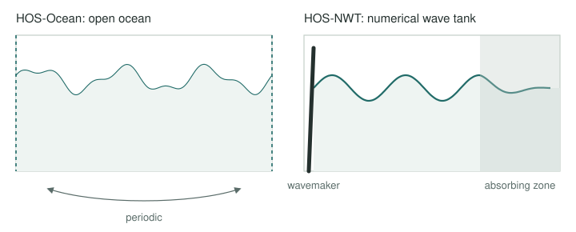

<p class="lead">The linear random-wave model represents the sea surface as a superposition of independent regular waves; the irregular waves in the <a href="/en/updates/wave-lab/">wave lab</a> are generated in this way. In real seas, the components exchange energy through nonlinear interactions: the spectrum evolves during propagation, and wave groups may focus into rogue waves much higher than the surrounding waves. Simulating these processes over large domains and long durations by solving the full governing equations is computationally prohibitive; the High-Order Spectral (HOS) method provides an efficient alternative.</p>

## The High-Order Spectral method

The HOS method was introduced by West et al. (1987) and Dommermuth & Yue (1987). It is based on potential-flow theory but retains the nonlinearity of the free-surface boundary conditions: the velocity potential is expanded in wave steepness up to a prescribed order $M$, each order is represented by Fourier series, and the computation uses fast Fourier transforms, so that the cost increases almost linearly with the number of modes. $M = 1$ corresponds to linear waves; higher orders describe the nonlinear interactions more completely.

## The two solvers

The LHEEA laboratory at École Centrale de Nantes has developed two open-source solvers based on the HOS method.

HOS-Ocean, developed since 2005, is intended for the open ocean. Its domain is periodic in the horizontal directions, and the initial wave field can be generated from spectra such as JONSWAP with directional spreading, for studies of spectral evolution and rogue waves over long propagation times. Recent versions include variable bathymetry, currents and wave-breaking models.

HOS-NWT, developed since 2003, is a numerical wave tank with a wavemaker at one end and an absorbing zone at the other. Waves are generated from the motion of a laboratory wavemaker, so that physical tank tests can be reproduced, including the nonlinearity introduced by the wavemaker motion itself.



Both solvers are written in Fortran, depend on FFTW and LAPACK, optionally support MPI parallelisation and HDF5 output, and are released under the GPL v3 licence. Since 2024 they have been maintained on GitLab, and the original GitHub repositories have been archived.

## Installation

Both solvers are compiled with CMake:

```bash
cmake -S. -Bbuild
```

```bash
cmake --build build -j
```

Pre-compiled executables for Linux and Windows are also provided on the release pages. HOS-Ocean reads its parameters from a YAML file, including the nonlinear order, the number of modes, the wave spectrum and the directional spreading; the documentation describes each parameter and the post-processing.

## Citation

- West B J, Brueckner K A, Janda R S, Milder D M, Milton R L. A new numerical method for surface hydrodynamics. *Journal of Geophysical Research*, 1987, 92(C11): 11803–11824.
- Dommermuth D G, Yue D K P. A high-order spectral method for the study of nonlinear gravity waves. *Journal of Fluid Mechanics*, 1987, 184: 267–288.
- Ducrozet G, Bonnefoy F, Le Touzé D, Ferrant P. HOS-ocean: open-source solver for nonlinear waves in open ocean based on high-order spectral method. *Computer Physics Communications*, 2016, 203: 245–254.
- Ducrozet G, Charlou M, Bonnefoy F. HOS-Ocean v2.1: extensions of a nonlinear wave solver based on the High-Order Spectral method. *Computer Physics Communications*, 2026, 323: 110098.
- Ducrozet G, Bonnefoy F, Le Touzé D, Ferrant P. A modified high-order spectral method for wavemaker modeling in a numerical wave tank. *European Journal of Mechanics B/Fluids*, 2012, 34: 19–34.
- Ducrozet G, Charlou M, Bonnefoy F. HOS-NWT: an open-source numerical wave tank based on the High-Order Spectral method. *Computer Physics Communications*, 2026, 325: 110168.
