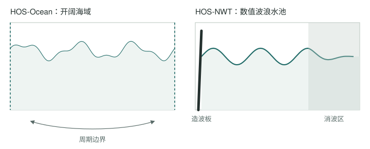

<p class="lead">线性随机波模型将海面视为大量规则波的叠加，各分量之间相互独立，<a href="/zh/updates/wave-lab/">波浪互动实验室</a>中的不规则波即按此方法生成。实际海浪中，不同分量之间通过非线性相互作用交换能量：波浪谱在传播过程中逐渐演化，波群也可能聚焦形成波高远大于周围波浪的畸形波。在大范围、长时间尺度上模拟这些过程时，直接求解完整的流体控制方程计算代价过高，高阶谱方法（HOS）为此提供了一种高效的途径。</p>

## 高阶谱方法

高阶谱方法由 West 等（1987）和 Dommermuth & Yue（1987）提出。该方法仍以势流理论为基础，但保留了自由面边界条件的非线性：将速度势按波陡展开至给定阶数 $M$，各阶均以傅里叶级数表示，并借助快速傅里叶变换求解，计算量随模态数近似线性增长。$M = 1$ 对应线性波；阶数越高，所能描述的非线性相互作用越完整。

## 程序简介

法国南特中央理工学院（École Centrale de Nantes）LHEEA 实验室开发了两个基于高阶谱方法的开源程序。

HOS-Ocean 自 2005 年起开发，适用于开阔海域。其计算域在水平方向上具有周期性，可由 JONSWAP 等波浪谱和方向分布函数生成初始波浪场，用于研究长时间传播过程中的波浪谱演化和畸形波。新版本还加入了地形变化、海流和波浪破碎模型。

HOS-NWT 自 2003 年起开发，是一个数值波浪水池：一端为造波板，另一端为消波区。程序可按实验室造波机的运动生成波浪，复现物理水池中的试验工况，并计入造波板运动本身引入的非线性。



两个程序均以 Fortran 编写，依赖 FFTW 和 LAPACK，可选用 MPI 并行计算和 HDF5 输出，以 GPL v3 许可证发布。自 2024 年起，代码迁移至 GitLab 维护，原 GitHub 仓库已归档。

## 安装

两个程序均使用 CMake 编译：

```bash
cmake -S. -Bbuild
```

```bash
cmake --build build -j
```

发布页面也提供 Linux 和 Windows 平台的预编译程序。HOS-Ocean 的计算参数在 YAML 文件中设置，包括非线性阶数、模态数、波浪谱和方向分布等，文档对各项参数及后处理方法均有说明。

## 引用

- West B J, Brueckner K A, Janda R S, Milder D M, Milton R L. A new numerical method for surface hydrodynamics. *Journal of Geophysical Research*, 1987, 92(C11): 11803–11824.
- Dommermuth D G, Yue D K P. A high-order spectral method for the study of nonlinear gravity waves. *Journal of Fluid Mechanics*, 1987, 184: 267–288.
- Ducrozet G, Bonnefoy F, Le Touzé D, Ferrant P. HOS-ocean: open-source solver for nonlinear waves in open ocean based on high-order spectral method. *Computer Physics Communications*, 2016, 203: 245–254.
- Ducrozet G, Charlou M, Bonnefoy F. HOS-Ocean v2.1: extensions of a nonlinear wave solver based on the High-Order Spectral method. *Computer Physics Communications*, 2026, 323: 110098.
- Ducrozet G, Bonnefoy F, Le Touzé D, Ferrant P. A modified high-order spectral method for wavemaker modeling in a numerical wave tank. *European Journal of Mechanics B/Fluids*, 2012, 34: 19–34.
- Ducrozet G, Charlou M, Bonnefoy F. HOS-NWT: an open-source numerical wave tank based on the High-Order Spectral method. *Computer Physics Communications*, 2026, 325: 110168.
